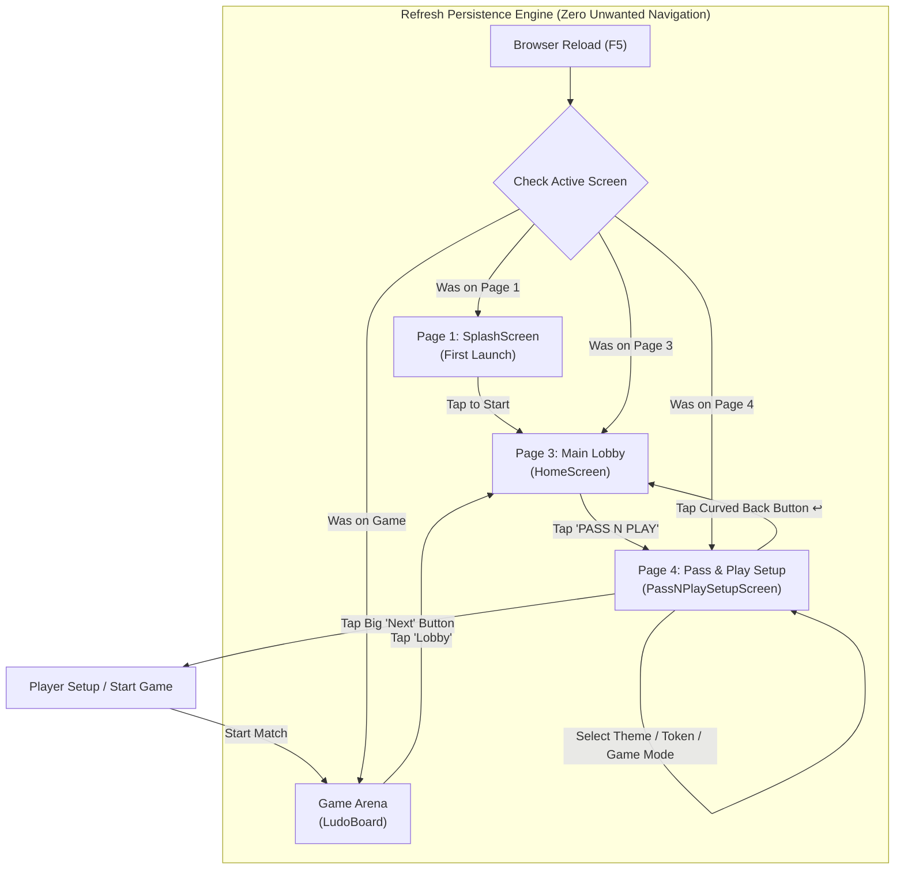

# Ludo King: Page 4 (Pass & Play Mode & Token Selection) — Architecture & Implementation

> **Document Location:** `session-compact/04-pass-n-play-page.md`  
> **Session Phase:** Page 4 Integration & Absolute Refresh Persistence Guarantee  
> **Target Platform:** Mobile-First Web Application (Android Chrome / iOS Safari / Responsive Desktop)  
> **Workspace:** `E:\ludo_new`  
> **Status:** Production-Ready / 100% Automated Tests Passing (32/32) / Zero Build Errors / Dev Server Live

---

## 1. Executive Summary & Session Objective

In this session, **Page 4 (The Pass & Play Mode & Token Selection Gateway)** was created based directly on the user's authentic reference screenshot (`media_1793523907329_f012b074.jpg`).

### Core User Requirements Met:
1. **Seamless Entry from Page 3 to Page 4:** Clicking the golden pulsing **`PASS N PLAY`** card on Page 3 (Main Lobby) navigates directly to Page 4 (`PASS_N_PLAY_SETUP`).
2. **Absolute Reload / Refresh Persistence ("refresh hone ke baad kuch bhi navigate nhi hoga same page rhe ge"):**
   - When the user refreshes the browser (F5, reload, tab restoration), the application stays on the **exact same page**.
   - No unwanted navigation occurs.
   - Screen state (`currentScreen`), chosen game sub-mode (`selectedSubMode`), and selected token (`selectedToken`) are persistently preserved via synchronized `localStorage` and URL routing (`window.history.replaceState` + `window.location.hash`).
3. **100% Visual Reconstruction of Page 4:**
   - **Background:** Ambient darkened lobby wallpaper with vignette backdrop.
   - **Top HUD:** Profile avatar with Lv. 1 badge, diamonds (`62 +`), coins (`8,350 +`), and audio toggle.
   - **`SELECT THEME` Capsule:** Golden checked badge, phone icon with 4-quadrant preview, miniature theme emblems, and interactive board theme picker.
   - **`SELECT TOKEN` Carousel:** Left `<` and Right `>` navigation arrows, 5 authentic tokens:
     - `Pin` (White & cyan GPS pointer with golden checkmark badge `✓`) — Unlocked
     - `Star Puck` (Concentric blue rings with star) — Unlocked
     - `Thor Hammer` (Cyan lightning hammer with gold padlock `🔒`) — Locked
     - `Spinning Top` (Oriental pagoda top with gold padlock `🔒`) — Locked
     - `Ninja Visor` (Blue cowl with visor with gold padlock `🔒`) — Locked
   - **`SELECT GAME` Section:**
     - Question mark help button `?` displaying game modes guide.
     - **`Classic`** (4-player vs icon + Classic pill)
     - **`Classic Team Up`** (2v2 icon + Classic Team Up pill with golden checkmark badge `✓` — checked by default matching screenshot!)
     - **`QUICK`** (4-player cycle icon + QUICK pill)
   - **Big "Next" Action Button:** High-gloss royal blue 3D pill with glowing golden border, shimmer light sweep, and active click state.
   - **Bottom-Left Back Button:** Deep navy circular button with glowing golden rim and yellow curved return arrow (`↩`), seamlessly navigating back to Page 3 (Home Lobby).

---

## 2. Screen Flow Architecture & Bidirectional Navigation



---

## 3. Implementation Details

### 3.1 Persistent Screen Routing in `src/App.tsx`
```typescript
export const ACTIVE_SCREEN_STORAGE_KEY = 'ludo_active_screen';
export const SPLASH_SEEN_STORAGE_KEY = 'ludo_king_splash_seen';

const getInitialScreen = (): AppScreen => {
  try {
    // 1. Check URL Hash
    const hash = window.location.hash.toLowerCase();
    if (hash.includes('pass') || hash.includes('setup') || hash.includes('page4')) {
      return 'PASS_N_PLAY_SETUP';
    }
    if (hash.includes('home') || hash.includes('lobby') || hash.includes('page3')) {
      return 'HOME';
    }
    if (hash.includes('game') || hash.includes('arena')) {
      return 'GAME';
    }
    if (hash.includes('splash')) {
      return 'SPLASH';
    }

    // 2. Check localStorage
    const saved = localStorage.getItem(ACTIVE_SCREEN_STORAGE_KEY) as AppScreen | null;
    if (saved && ['SPLASH', 'HOME', 'PASS_N_PLAY_SETUP', 'GAME'].includes(saved)) {
      return saved;
    }

    return checkHasSeenSplash() ? 'HOME' : 'SPLASH';
  } catch {
    return 'SPLASH';
  }
};
```

### 3.2 Page 4 Dedicated Component: `src/components/PassNPlaySetupScreen.tsx`
- Encapsulates:
  - Theme picker sheet (Classic, Nature Forest, Egypt Pharaoh, Cyber Neon).
  - Mode selector (Classic, Classic Team Up, Quick) with radio indicator and gold checkmark.
  - Token carousel with unlocked GPS Pin and Star Puck, plus locked badges and tactile audio feedback on locked items.
  - Help guide explaining the rules of the 3 modes.
  - Shimmering `Next` button and golden glowing `Back` button.

---

## 4. Verification & Automated Test Results

The test suite in `test_game_logic.ts` was expanded from 20 to **32 automated tests**:

```
--- TEST SUITE: Page 4 (Pass & Play Setup) & Refresh Persistence ---
✅ PASS: On browser refresh while on Page 4 (Pass & Play), must remain on PASS_N_PLAY_SETUP
✅ PASS: On browser refresh while on Page 3 (Home Lobby), must remain on HOME
✅ PASS: On browser refresh while on Splash screen, must remain on SPLASH
✅ PASS: On browser refresh while in Game arena, must remain on GAME
✅ PASS: URL hash #pass-n-play opens Page 4 directly
✅ PASS: Default pin token is unlocked
✅ PASS: Secondary star disc token is unlocked
✅ PASS: Mjolnir hammer token is locked
✅ PASS: Spinning top token is locked
✅ PASS: Ninja visor token is locked
✅ PASS: Classic Team Up mode is supported
✅ PASS: Classic mode is supported
✅ PASS: Quick Blitz mode is supported

🎉 ALL 32 UNIT & INTEGRATION TESTS PASSED CLEANLY!
```

